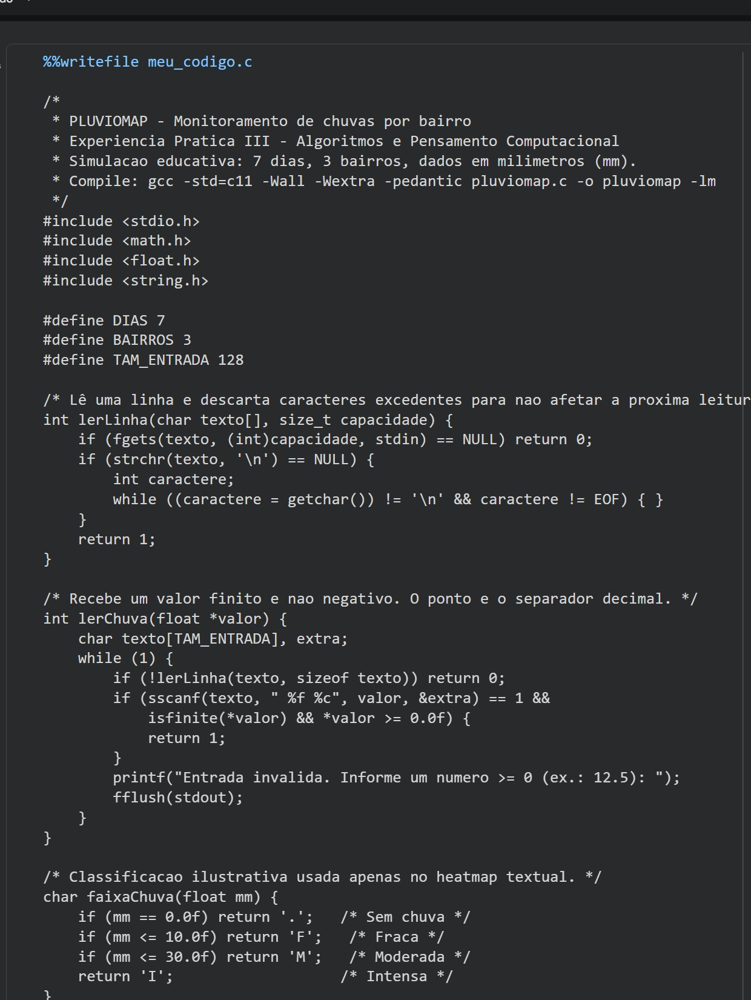
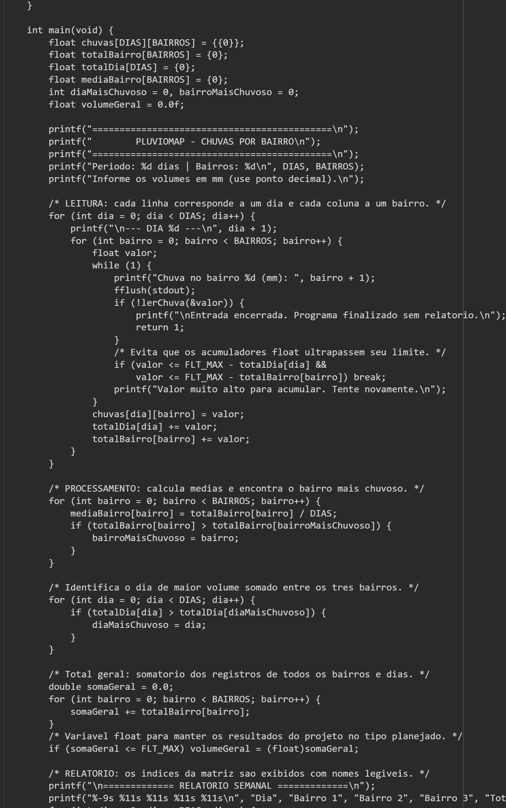
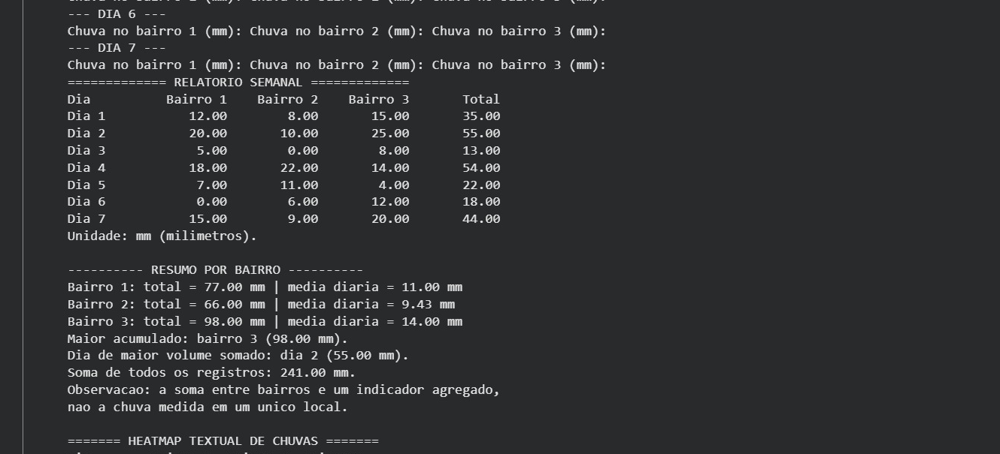
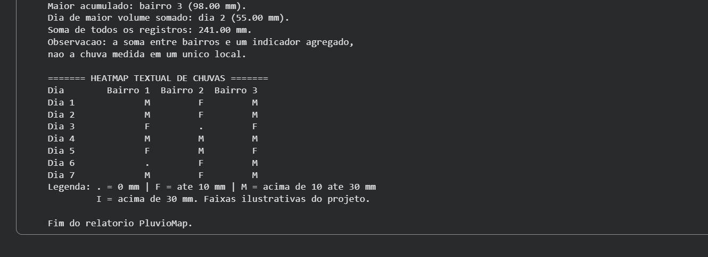
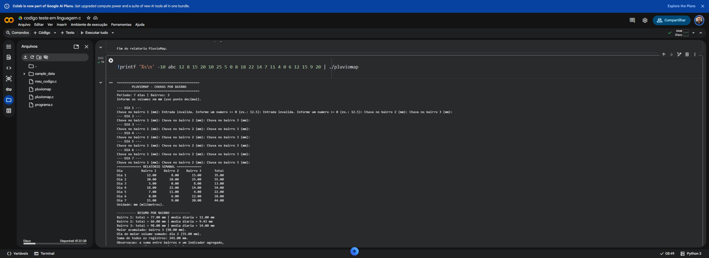

<h1 align="center">🌧️ PluvioMap — Monitoramento de Chuvas em C</h1>

<p align="center"><strong>Algoritmos e Pensamento Computacional • Experiência Prática III</strong></p>

<p align="center">


</p>

## 📌 Sobre o projeto

O **PluvioMap** é um programa em linguagem C que simula o monitoramento da quantidade de chuva em **3 bairros ao longo de 7 dias**. Os registros em milímetros (mm) são informados pelo usuário e organizados em uma matriz `7 × 3`. Não há uso de sensores nem dados meteorológicos reais.

A proposta é aplicar lógica de programação e estruturas de dados à organização e análise de informações, gerando um relatório semanal e um mapa de intensidade **textual**.

## ✨ Funcionalidades

- Entrada de **21 registros** de precipitação;
- Validação contra valores negativos, textos e valores não finitos;
- Armazenamento em matriz bidimensional `chuvas[DIAS][BAIRROS]`;
- Cálculo de totais e médias por bairro;
- Identificação do bairro com maior acumulado e do dia com maior volume agregado;
- Relatório semanal tabular e **heatmap textual** com faixas ilustrativas.

> Os valores são simulados. A soma entre bairros é um indicador agregado do exercício e não a chuva medida em um único local. As classes de intensidade não seguem uma classificação meteorológica oficial.

## 🧠 Conceitos e evolução em C

`Matrizes` • `Arrays` • `for` • `while` • `Funções` • `Ponteiros` • `Validação de dados` • `Acumuladores` • `Relatórios`

Comparado ao projeto [BancoTech](https://github.com/iagovitobatista/bancotech-sistema-bancario-c), o PluvioMap reforçou o uso de **matrizes, arrays e laços de repetição**, permitindo tratar diferentes registros com o mesmo conjunto de funções e estruturas de controle.

## ▶️ Como executar

Requer um compilador C compatível com C11, como o GCC.

```bash
gcc -std=c11 -Wall -Wextra -pedantic pluviomap.c -o pluviomap -lm
./pluviomap
```

O programa foi desenvolvido e testado no **Google Colab**. Digite números usando ponto decimal (por exemplo, `12.5`).

## 🧪 Exemplo de saída — simulação

| Indicador | Resultado |
| --- | ---: |
| Total do Bairro 1 | 77 mm |
| Total do Bairro 2 | 66 mm |
| Total do Bairro 3 | 98 mm |
| Bairro com maior acumulado | Bairro 3 |
| Dia com maior soma | Dia 2 — 55 mm |
| Soma geral dos registros | 241 mm |

Os resultados acima são de uma execução de teste com dados simulados.

## 🖼️ Evidências do projeto

As imagens abaixo registram o desenvolvimento e a execução da atividade no ambiente de programação.

### 1. Organização do código e funções

Demonstração das funções auxiliares utilizadas para organizar o programa e validar dados de entrada.



### 2. Matriz bidimensional e estruturas de repetição

Utilização de uma matriz de 7 dias por 3 bairros, percorrida com laços de repetição para registrar e processar os volumes de chuva.



### 3. Relatório de resultados

Apresentação das informações processadas, incluindo acumulados, médias e identificação dos maiores volumes.



### 4. Heatmap textual

Representação das intensidades simuladas de chuva por dia e bairro, utilizando símbolos e uma legenda ilustrativa.



### 5. Testes de validação

Registro dos testes realizados com entradas para verificar o tratamento de dados inválidos.



## 🎓 Contexto acadêmico

Projeto desenvolvido durante a **Experiência Prática III de Algoritmos e Pensamento Computacional**, na graduação em **Análise e Desenvolvimento de Sistemas**.

---

<p align="center">💡 Aprendendo, construindo e evoluindo a cada projeto.</p>
